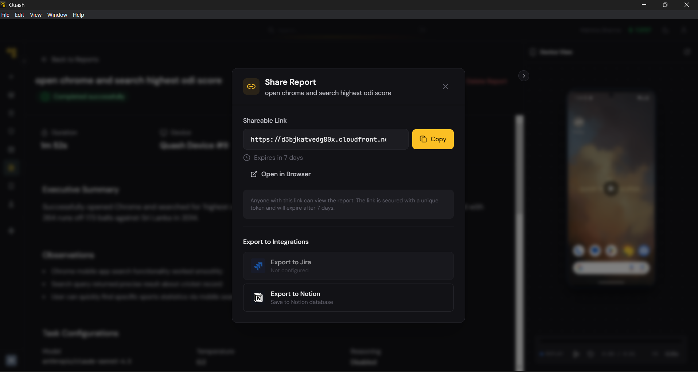
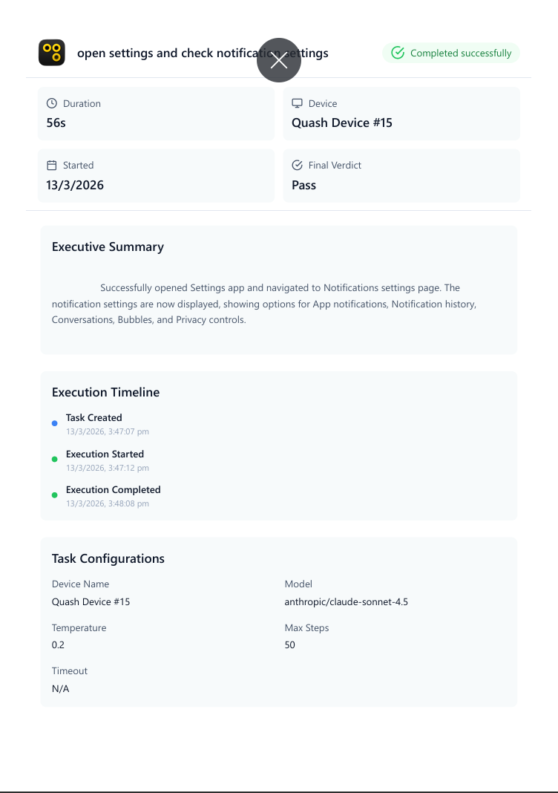

* **Share** — Generates a shareable link to the report. Anyone with the link can view the full report without needing to log in to Quash.
* **Web View** — View the report directly in the browser with full step-by-step context and device visuals.
* **Download PDF** — Exports the complete report as a PDF, including the executive summary, observations, task configurations, execution timeline, and full step-by-step breakdown with screenshots.

* **Delete Report** — Permanently removes the report from your workspace. This action cannot be undone.

> 💡 **Error** means the run hit an execution problem rather than a failed product check — for example, a CAPTCHA, a loading screen that timed out, or a modal the agent wasn't instructed to handle. Check Observations first, then look at the screenshot where the run stopped.
